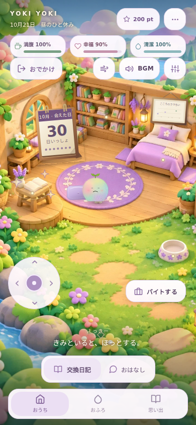
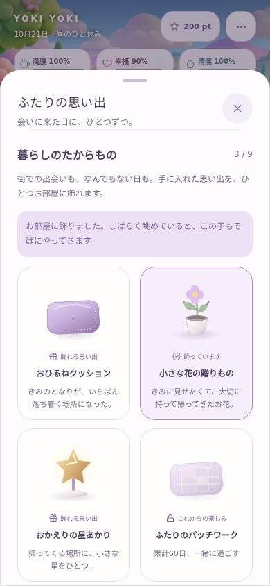

# 柔らかな暮らしと、残っていく思い出

キャラクターと背景の原形を保ちながら、ホーム・地図・お店・模様替え・日記や物語のシートをミルク色とラベンダーで統一しました。角丸、文字色、影を揃え、歩き出し・停止・振り向き・呼吸が途切れない動きに調整しています。

| お部屋 | 思い出のコレクション |
| --- | --- |
|  |  |

画像はローカルの検証データです。

## 遊びの変更

- 来訪を累計で数え、3・10・30日で進化。休んでも退化せず、過去に到達した姿も引き継ぎます。日記の経験値・記録日数とは別の記録です。
- 7・14・30・60・100日の来訪、ボウリング、初収穫、街の物語の完読で、計9種類の思い出が増えます。期限や購入費はありません。
- 思い出はカレンダー、またはホームメニューから選択。ひとつを部屋のラグのそばに飾れます。クッション・毛布なら休み、それ以外は眺める行動が加わります。獲得済みのものと「しまう」の選択は保存します。
- 銀行を地図・移動・取引から外しました。既存の預金残高は手持ちポイントへ一度だけ返し、取引履歴は残します。
- 喫煙の依存・禁断症状・禁煙カウントによる減点を終了。タバコ屋と任意の一服は維持し、iOSでは従来どおり表示しません。
- カレンダーを拡大し、気分の記録も同じ部屋から確認できます。清潔度はからだと部屋を合わせた表示に統合し、幸福度は経過時間と滞在記録で更新します。

## 動きと保存の実装

呼吸と歩行の周期を独立させ、歩き始め・止まり際に揺れを徐々に切り替えます。向きはフレームごとに追従させ、同じアニメーションを毎フレーム作り直さない構成です。Webの進化後キャラクターの30fps制限を外し、回転計算と毛の描画負荷を削減しました。非表示中の停止と「視差効果を減らす」設定は維持しています。

累計来訪は日付の和集合で重複を防ぎます。旧形式で切り詰められた日付履歴には集計境界を持たせ、古い端末の記録との統合で二重加算しないようにしています。銀行返還とコレクション選択は既存の復旧可能な保存トランザクションを利用します。

## 確認

- Nodeの回帰テスト：703件成功、失敗0件、任意のネイティブ配信試験1件をスキップ。
- TypeScriptの型チェック、Web・iOS・AndroidのExpoエクスポート成功。
- ブラウザーで320×568、390×844、820×1180の獲得・選択・再読込・返還の重複防止を確認。
- カレンダー・気分の額・既存の操作箇所の重なりを、上記3サイズと844×390の横向きで確認。
- 通常のアニメーションで、クッションへの歩行と休息、花への切り替えと鑑賞を確認。
- 抱っこ・着地・歩行・カメラ追従・移動先の変更・移動不可領域・シート中の停止を確認。小画面・タブレット・横向き・夜の画面で、キーボード操作と「視差効果を減らす」設定も確認。
- ローカルChromium 153の同条件のCanvas描画比較（ウォームアップ20フレーム、計測80フレーム）：中央値9.7ms→5.1ms。描画処理のみの参考値で、アプリ全体のfpsや実機性能を表すものではありません。

ネイティブ確認はJavaScript/Hermesバンドルのエクスポートまでです。実際のiPhone・Android端末での手触り、サインインした本番アカウントのクラウド同期、App Store用バイナリの作成・提出はこの変更では実施していません。

公開環境への反映は行っていません。`codex/fix-app-startup-20261022` を土台にしたレビュー用ブランチです。
