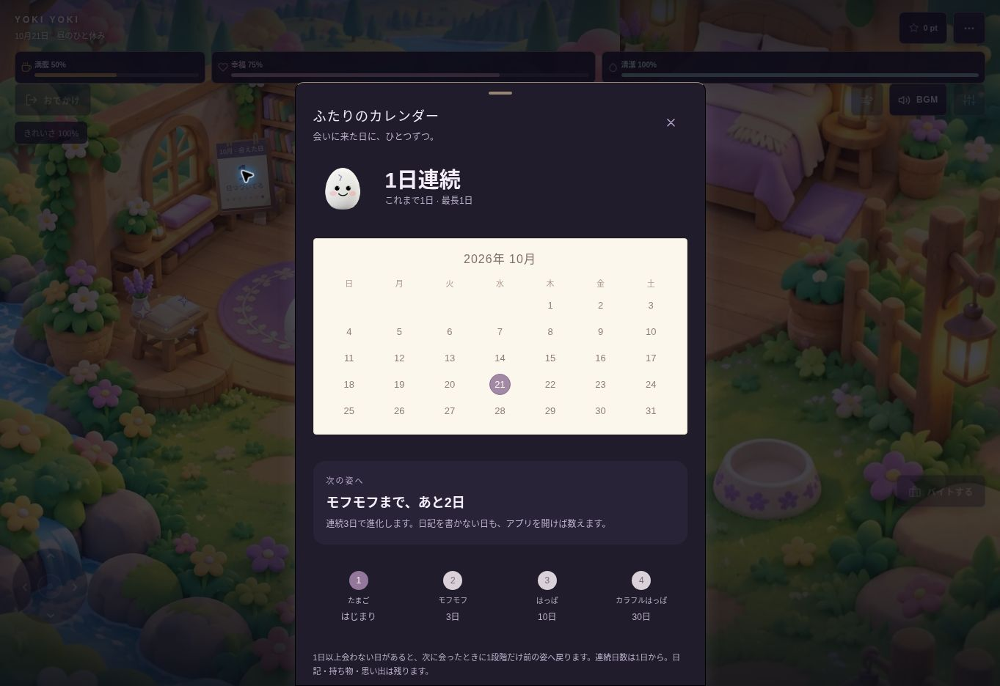

# 部屋のカレンダー・気分の額：再開と検証記録

2026年10月21日。「マップ表示とチャット修正」の中断箇所から再開。

## ブラウザ版公開済み — 2026年10月21日

ユーザーの「ブラウザ版だけ公開してみて」に基づき、既存の https://yoki-yoki.replit.app/ へ再公開。Replitの公開状態 `success` と実際の公開画面への反映を確認した。

- GitHubソース `5834962f27c88987c80dbcb2402c0131fefdcacc` の差分を、Replitの既存状態を保って適用。Replit反映コミット `e9650a728c305fb89c9f08708dcb3774fb47739a`。
- 反映前をReplitの `backup/yoki-before-browser-calendar-20261021` に保存。実装・依存ファイルが検証済みソースと一致し、Replitでも関連18テストとモバイル型チェックが成功。
- 既存の公開設定で1回だけ再公開。Replit Agent、追加課金、DB変更、App Store用のビルド・提出・審査変更は実施していない。提出済みビルド24には今回の機能を追加していない。
- 公開URLで確認用ゲストを使用し、カレンダーの1日連続・次の進化まで2日、気分の7日間の未記録表示、両シートの開閉を確認。再読み込み後も1日連続を保持し、地図の開閉とチャット画面への移動・帰宅も成功。
- 公開後の確認はブラウザ操作。実AIへの送信、広告視聴、ユーザーアカウントのデータ操作、物理端末での検証はしていない。

## 対象

- PR: https://github.com/NkgwYYY/YOKI-YOKI/pull/5
- Branch: `codex/home-calendar-evolution-20261021`
- 検証対象ソース: `7d8ce7fb5618454a9d5c7531421967ac303546db`
- 既存のビルド24提出済みソース `75839160398fe9f445958efd48a14276d94948d8` からの追加。ブラウザ版は上記のとおり公開済み。ネイティブ版への反映は次回更新用。

## 仕様

- 部屋のカレンダーに連続訪問日数を表示。タップで訪問日・最長記録・次の進化までの日数を確認。
- 気分の額に直近7日間の実際の記録を表示。記録のない日を補完しない。
- 連続3日でモフモフ、10日ではっぱ、30日でカラフルはっぱ。日記を書かない日もアプリを開けば数える。
- 1日以上会わない日があった場合、次回訪問で1段階だけ戻り、連続日数を1日から再開。同日の再起動では重ねて戻らない。
- 既存形態を引き継いで計測を開始し、過去の訪問日は創作しない。経験値・日記・持ち物・図鑑の履歴・解放済みの場所は保持する。

## 再開後の修正

- 小さい縦画面では棚の前、横画面では既存の操作範囲を避けた位置にカレンダーと額を配置。画面端には回転分の余白を確保。
- 横画面のカレンダーと交換日記の48pxのタップ範囲の重なりを修正。
- 初回のサイズ未測定時にカメラが `-136px` を計算する不具合を修正。サイズ未確定では中立位置を保ち、測定結果をリアクションの入力に含める。
- ブラウザー検証では読み込み画面の終了を待ち、要素の自動スクロールを伴わない実際の画面座標への入力を使う。クリック前に最前面の要素と衝突範囲を確認する。

## 検証

- ローカル: モバイル型チェック、訪問日数・進化・日付処理・カメラ・移動経路の18テスト成功。
- 最終CI: https://github.com/NkgwYYY/YOKI-YOKI/actions/runs/39544593490
- 最終CI: 全ステップ成功。既存のNodeテストは722件成功・1件スキップ・0件失敗。共有／モバイル／APIの型チェック、隔離DB、Web操作、Web・iOS・AndroidのJS／素材書き出しを含む。
- カレンダー／額の操作は320×568、390×844、844×390、820×1180で成功。3・10・30日の進化、長期欠席後の1段階戻り、再読み込み、昼夜、日付変更、気分の未記録日を確認。
- 画像・テスト証跡: Actions artifact `12320608155`、SHA-256 `eb2ec9429f39924d4e6c546010c15d1501d0dbda8145e29ec938bc2decb3b685`。合成データのみ。原本はActionsに7日保存。
- 実際の画像で小型縦画面、通常縦画面、横画面、タブレット、夜間、カレンダー、気分のグラフを確認。小型画面の詳細シートはスクロールでき、閉じる操作は上部にある。

## 確認範囲

上記CIのブラウザー検証は合成データを用い、外部サービスへの通信を遮断する。公開後の実サイト確認とは別の証拠であり、いずれも実際のAI応答、広告配信、認証済みクラウド同期、物理端末、署名済みiOS/Androidバイナリーの動作を証明するものではない。JS・素材の書き出しとネイティブ配布は区別する。

以前の失敗した検証を成功として扱わない。最終ソースと上記CIを再開の基準にする。
