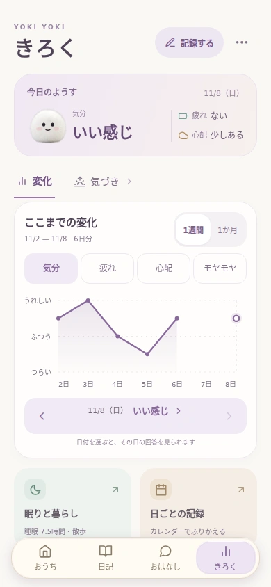

# A focused record overview

The record tab previously placed today's three answers, eight graphs, and several categorical grids in one continuous column. The initial view now contains a compact summary and one selectable graph. Sleep and daily-life answers open in a focused sheet; a calendar leads to a consolidated day detail.

- Keep the original condition scales, missing days, and recorded zero values. Do not connect graph lines across missing answers.
- Browse mood, fatigue, worry, and Moyamoya in the main graph. Sleep, meals, exercise, relationships, daily activities, day type, and Moyamoya topics remain available in the detail sheet.
- Activity counts include only answered days. Explicitly unselected, unanswered, and selected stay distinct.
- Period changes keep the selected day in range. Historical browsing never writes records or spends points.
- The edit entry opens the existing unified daily form. Startup, optional-answer behavior, rewards, and battle selection are retained.
- Correct the mood portrait's SVG layer order so the expression is visible over its existing body image.

## Validation

- TypeScript typecheck passed.
- Web and iOS JavaScript exports passed. A new signed iOS build was not created for this UI preview.
- 26 existing condition, life-answer, and record-transaction tests passed.
- `tests/condition.browser.cjs`: 390×844, 320×568, 768×1024, empty records, metric and period navigation, date details, zero-vs-missing answers, activity categories, calendar, insight/report routes, and unchanged records/wallet.
- `tests/unifiedRecord.browser.cjs`: first daily entry, optional answers, one save, existing Moyamoya encounter/battle, diary/points retention, no repeated prompt, manual entry; passed at 390 and 320 pixels.
- The overview's measured scroll height with the same fixture went from 5,679px to 926px at 390px width, and 936px at 320px width. Calendar/life details appear only when opened.
- The native record journey has been adapted to the new navigation; this updated XCTest has not yet been executed on a simulator.

The screenshot uses fictional data from the browser test, not a user's saved records. The app version/build number is unchanged in this design branch.
